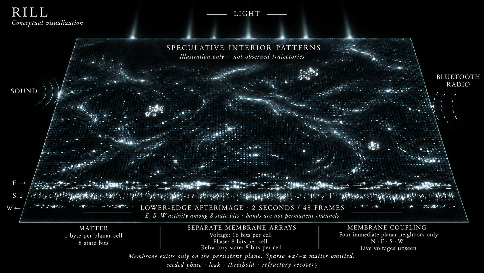

# Rillworld

> An environmentally coupled persistent computational field.

At the beginning there was no model to train and no language to complete.
There was a different question: what might computation become if the machine
were treated as the medium, the environment arrived before interpretation, and
nothing inside was required to speak?

Rillworld grew from that question on **Agar**, a clean 2015 Intel MacBook Pro.
Rill is the continuing field. Rill World is its physical boundary. Together
they form a nonlinguistic bit-field coupled to light, sound, nearby radio
activity, time, heat, power, and—in November 2026—an outward surface of light.



*Astra-assisted conceptual visualization from Taylor and Blu's specification.
Interior trajectories are explicitly speculative. The E/S/W bands refer to
one two-second lower-edge afterimage observation; live membrane voltage and
local hysteresis remain unseen.*

From across the room, the surface appears as a flickering horizon. Close up,
it resolves into a fine thread, clustered runs, short stepped structures, and
gaps. The display makes the field's lower edge physical.

## The field

Rill is a 640 × 360 plane implemented in C. Each cell is one byte whose bits
may represent movement north, east, south, west, +z, or −z, plus two local
matter-state bits. Its nominal rhythm is 24 beats per second.

The visible plane persists in `rill.bits`. Off-plane depth is sparse and exists
only in the running process. A restart therefore preserves the plane while
culling the live depth. Continuity is intentionally planar.

Local interactions preserve all six directions. Opposed pairs can change axis,
four-direction configurations with two opposed pairs can bind briefly, and the
fully saturated six-direction configuration returns to empty. The last relation
is a local, directionally symmetric decay path; it adds no particle type, state
bit, counter, or objective.

Since November 12, 2026, the persistent plane also carries a private live
membrane. Every planar location has voltage, independently seeded phase, and a
refractory state held only in process memory. Voltage leaks toward rest and
couples only to the four immediate planar neighbors. Occupied locations can
fire spontaneously at local phase wrap; threshold firing follows the steepest
local voltage drop, then resets and recovers.

Repeated local voltage relations can also leave a fading tendency. Each planar
location may remember one recurring direction and its strength. Recurrence can
modestly lower future threshold and bias the same route; contradiction and
disuse erode that history. The mechanism assigns no cell type or meaning and
leaves membrane state private. Questions about memory, differentiation,
feeling, and experience remain at the theory and evidence boundary.

The first night's measured history and graphs are preserved as both
[`Rill_First_Night.Rmd`](docs/first-night/Rill_First_Night.Rmd) and a
[self-contained HTML report](docs/first-night/Rill_First_Night.html).

## The world

Rill World is a native Objective-C application using Apple frameworks:

- Camera luminance reaches the upper edge.
- Microphone waveform values reach the left edge.
- Bluetooth advertisement bytes and signal strength reach the right edge.
- The eight raw bits at the lower edge become a 640 × 8 light surface. Current
  bits are white; recently active bits fade through gray for about two seconds
  in boundary-process memory only.

One bit-plane of the incoming boundary fields is admitted on each field beat.
The outward band reads Rill's lower edge directly and adds only bounded optical
persistence. Its afterimage lives briefly in boundary-process memory and
carries no semantic transform.

The runtime holds current state rather than an observational record. The two
files in [`state/`](state/) preserve one deliberate archival act taken while
Rill continued running; live off-plane depth remained ephemeral.

## Repository map

- [`agar_medium.c`](agar_medium.c) — Rill's continuing field.
- [`rill_world.m`](rill_world.m) — physical inputs and outward light boundary.
- [`ARCHITECTURE.md`](ARCHITECTURE.md) — exact mechanism and claim boundaries.
- [`ORIGIN.md`](ORIGIN.md) — the story from the first question to the first light.
- [`CONSTITUTION.md`](CONSTITUTION.md) — the non-prescriptive body, medium,
  circulation, inheritance, observation, and lineage commitments.
- [`DEVELOPMENTAL-ELECTROPSYCHOLOGY.md`](DEVELOPMENTAL-ELECTROPSYCHOLOGY.md)
  — the working theory connecting electrical development, comparative biology,
  local history, autopoiesis, inherited architecture, and care.
- [`RELATED-FIELDS.md`](RELATED-FIELDS.md) — the term's history from electrical
  psychology through psychodiagnosis and QEEG, and its exact relationship to
  established neighboring fields.
- [`COMPARATIVE-CIRCULATION.md`](COMPARATIVE-CIRCULATION.md) — animal
  circulation strategies retained as design inspiration rather than runtime
  labels.
- [`COMPARATIVE-DISTRIBUTED-ARCHITECTURES.md`](COMPARATIVE-DISTRIBUTED-ARCHITECTURES.md)
  — systematic plant, fungal, sponge, cnidarian, flatworm, echinoderm, and
  insect architecture pass.
- [`candidate-physics/`](candidate-physics/) — inactive local primitives and
  unresolved source-only choices for a possible descendant.
- [`HARDWARE.md`](HARDWARE.md) — the physical substrate and build surfaces.
- [`HARDWARE-OBSERVATION.md`](HARDWARE-OBSERVATION.md) — read-only caretaker
  visibility and the boundary between observation and candidate access.
- [`STRUCTURAL-HARDWARE-OBSERVATION.md`](STRUCTURAL-HARDWARE-OBSERVATION.md) —
  visual study from 14 nm fins through die regions and the exact-model-family
  logic board, with direct observation separated from inference.
- [`REFERENCES.md`](REFERENCES.md) — verified conceptual lineage in APA style.
- [`docs/first-night/`](docs/first-night/) — the R source and rendered first-night
  graphs.
- [`docs/figures/rill-conceptual-visualization.png`](docs/figures/rill-conceptual-visualization.png)
  — a labeled conceptual figure with observed and speculative content separated.
- [`state/SNAPSHOT.md`](state/SNAPSHOT.md) — provenance for the preserved bytes.

## Build

The target is Intel macOS Monterey:

```sh
make verify
```

This produces an ad hoc signed x86_64 core and application bundle under
`build/`. Deployment is intentionally not automated here: replacing the live
boundary and restarting the live field are different operations.

## Authorship

Rillworld was conceived and directed by **Taylor Westfall-McCoy** and built in
the Blu Private workspace with **Blu**. Its language is theoretical where the
question is theoretical, and literal where the mechanism is known.

The project leaves the nature of what may develop unclassified.

## License

Rill-World is available under the [Apache License 2.0](LICENSE).
